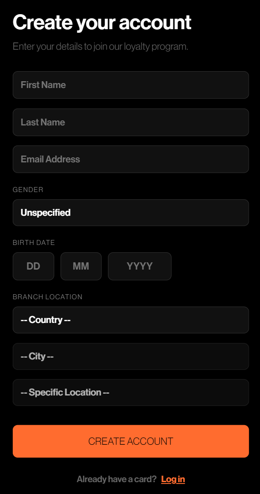
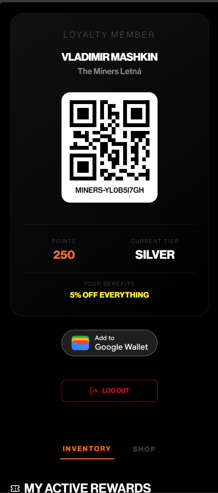
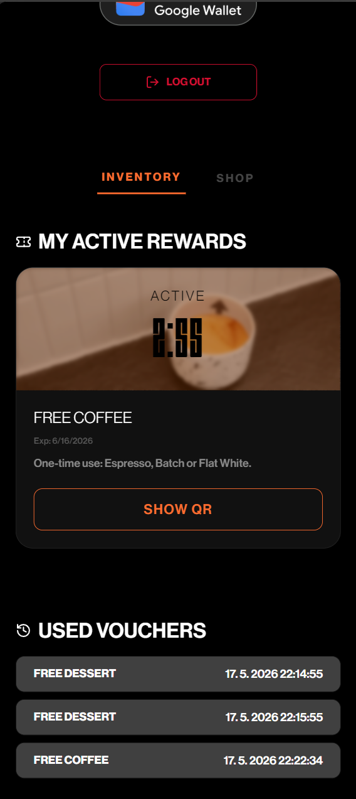
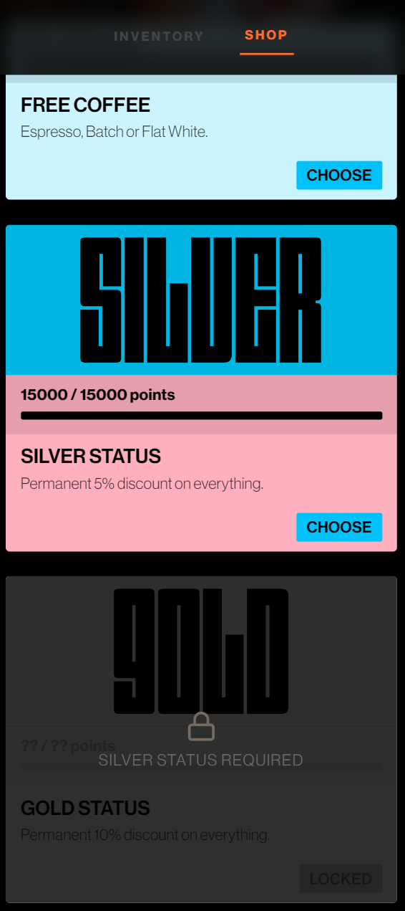
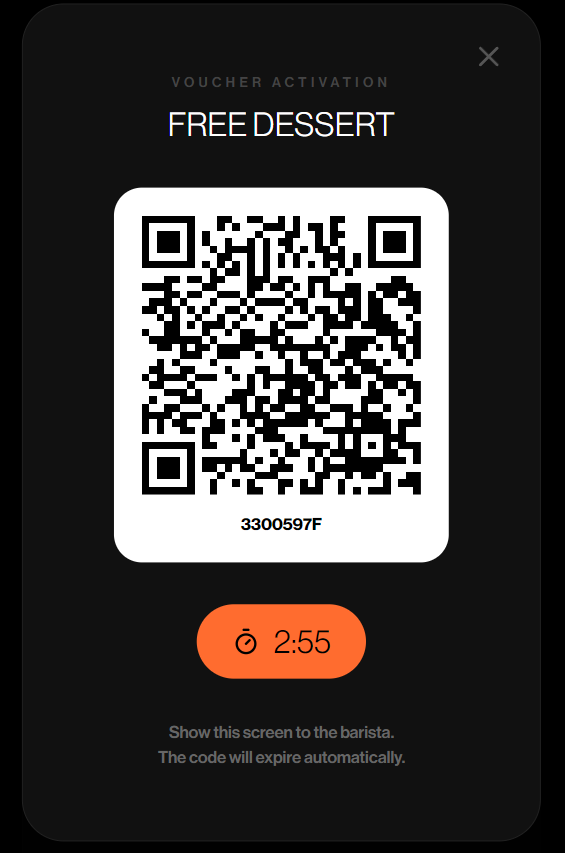
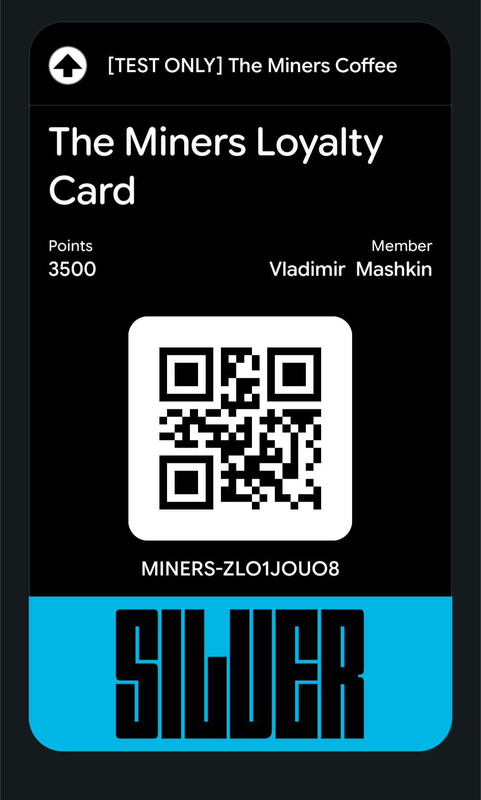
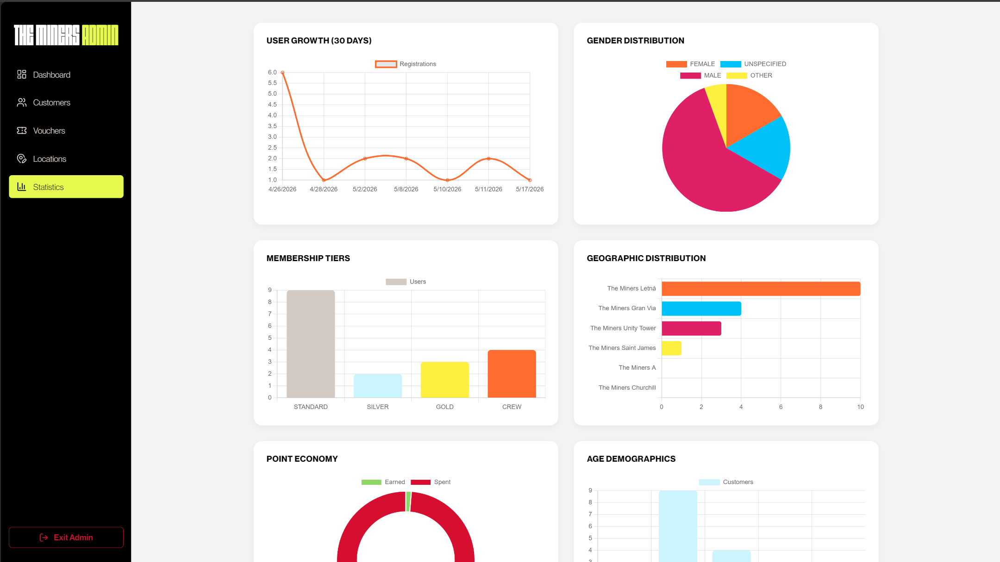
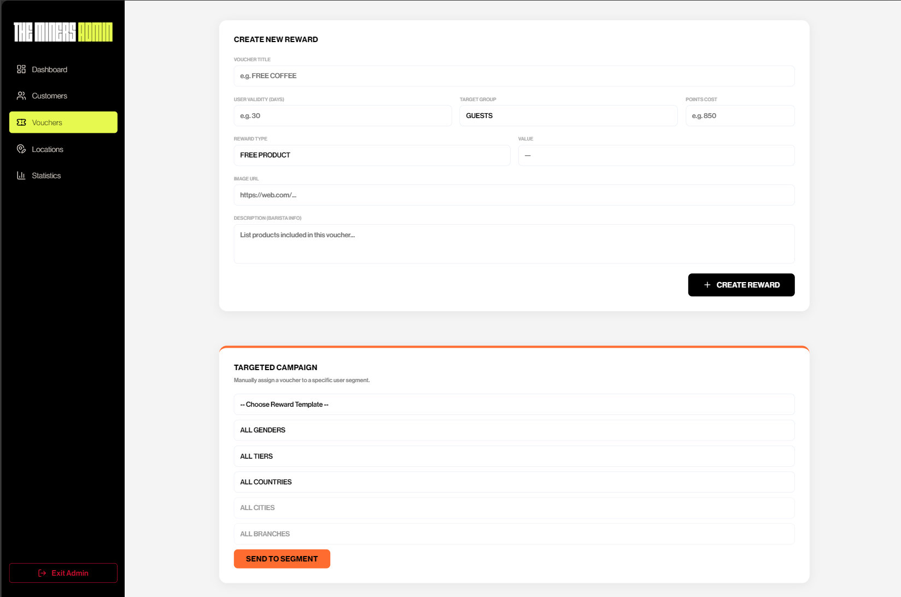

# The Miners Coffee — Loyalty System

Full-stack loyalty card platform for a multi-country coffee chain: customers collect points, buy vouchers and add their card to Google Wallet, while staff manage branches, users and campaigns from an admin panel.

Bachelor's thesis project by Vladimir Mashkin, CTU FEL, 2026.

> The live demo is offline (free hosting expired). Screenshots are below; the project runs locally in a few minutes.

## Screenshots

### Customer app
<p>
  
  
  
  
</p>
<p>
  
  
</p>

### Admin panel



## Features

**Customers**
- Registration and a personal loyalty card with a points balance
- Tiers: Standard, Silver and Gold passes unlocked with points, plus a staff Crew pass
- Voucher market where points are exchanged for vouchers, and voucher redemption
- Add the card to Google Wallet

**Admin panel**
- Secure admin login (JWT, bcrypt)
- Dashboard and statistics (Chart.js)
- Management of branches, users and vouchers
- Bulk campaigns that gift vouchers to users

**Backend**
- REST API with Swagger / OpenAPI 3.0 documentation
- PostgreSQL schema with SQL setup and migration scripts
- 42 automated tests (unit, integration and voucher logic)

## Tech Stack

| Layer | Technology |
|-------|-----------|
| Frontend | React 19, Vite, TailwindCSS, Chart.js |
| Backend | Node.js, Express 5, PostgreSQL |
| Auth | JWT, bcryptjs |
| Wallet | Google Wallet API |
| Tests | Jest, Supertest |
| Docs | Swagger / OpenAPI 3.0 |

## Project Structure

```
miners-loyalty-system/
├── client/   # React 19 + Vite frontend
└── server/   # Node.js + Express 5 backend
    ├── routes/    # user, loyalty, branch and admin routes
    ├── scripts/   # SQL setup and migrations
    └── tests/     # Jest + Supertest
```

## Running Locally

### Prerequisites
- Node.js 18+
- PostgreSQL 14+

### Backend

```bash
cd server
npm install
```

Create a `.env` file in `server/`:

```env
PORT=5000
DB_HOST=localhost
DB_PORT=5432
DB_NAME=miners_loyalty
DB_USER=postgres
DB_PASSWORD=your_password
JWT_SECRET=a_long_random_string
```

Set up the database:

```bash
psql -U postgres -c "CREATE DATABASE miners_loyalty;"
psql -U postgres -d miners_loyalty -f scripts/setup.sql
```

`setup.sql` creates a default admin (`admin`). Change its password right away:

```bash
node scripts/hashAdminPassword.js <new_password>
```

and run the `UPDATE` statement it prints.

Start the server:

```bash
npm start
```

API: `http://localhost:5000`, Swagger UI: `http://localhost:5000/api-docs`

### Frontend

```bash
cd client
npm install
npm run dev
```

The app runs at `http://localhost:5173`.

## Running Tests

```bash
cd server
npm test
```

## Google Wallet

The integration works in test mode: the "Add to Google Wallet" button only works for Google accounts added as test users in the Google Pay & Wallet Console. This is a restriction of the Google Wallet API in development mode and does not affect any other functionality.

## Status

Working prototype, not released to production. Needed for a production launch: POS integration, Apple Wallet support and AI-based features.
